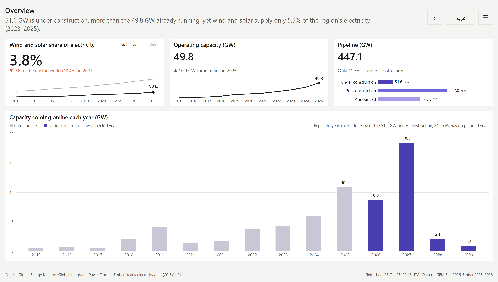
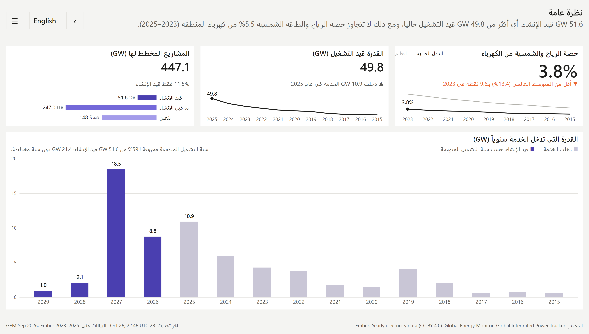
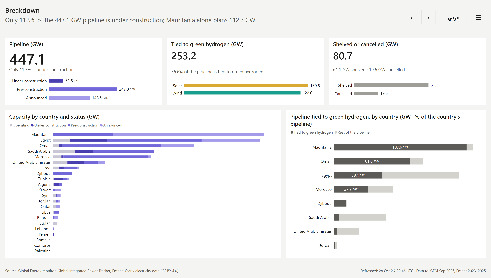
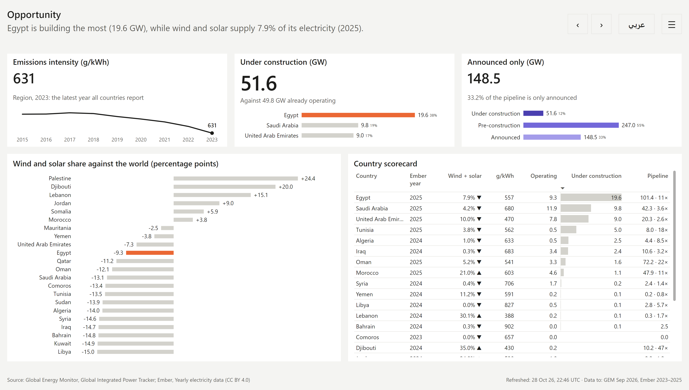
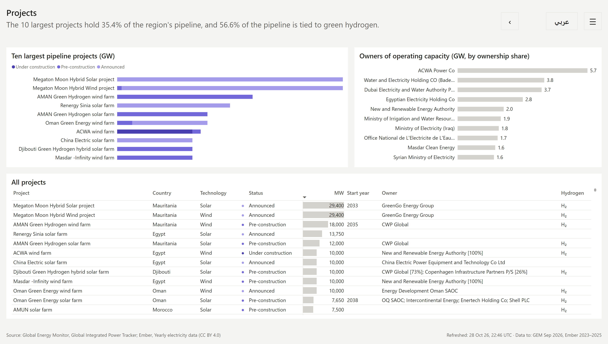
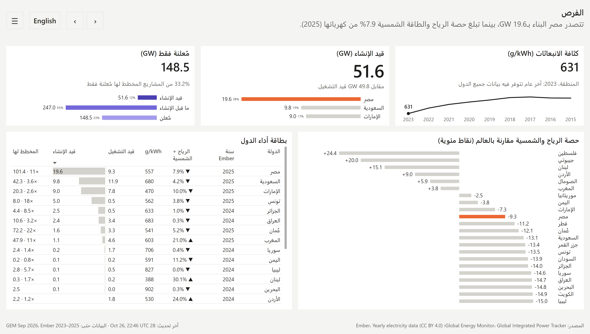
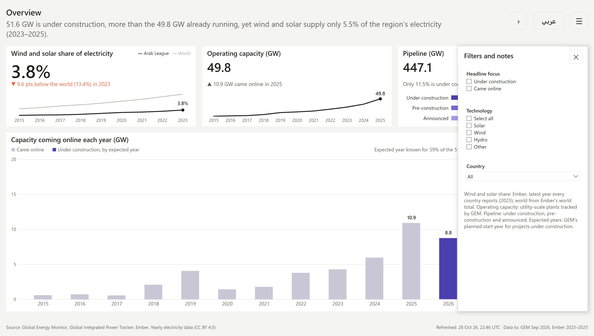
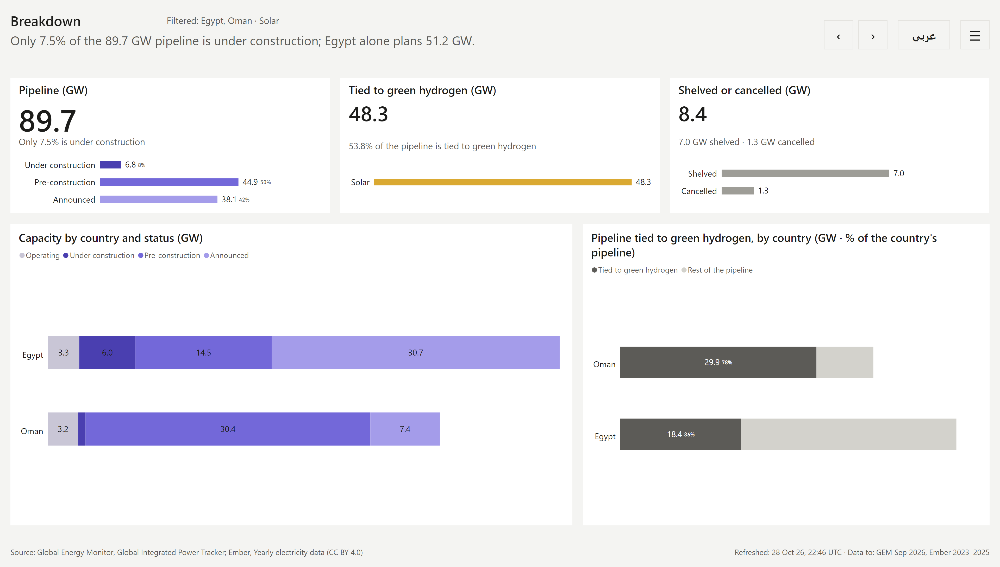
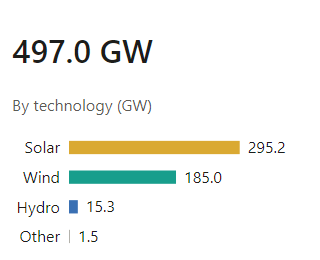

# Renewable power in the Arab League: a bilingual Power BI report

A Power BI report on wind, solar and hydro power across the 22 Arab League countries, built in **English and Arabic**. Every page has a right-to-left Arabic twin that is generated, not hand-built: positions, axes, tables, text direction and navigation are mirrored by a script from the English page.

The whole report is **written as code** (PBIP: PBIR report + TMDL model), built and mirrored by Python scripts, validated against Microsoft's schemas, deployed to Microsoft Fabric with the Fabric CLI, and checked from rendered PNGs before every review.

| English | Arabic (generated mirror) |
|---|---|
|  |  |

## The question it answers

The report is written for a **market-screening team at a renewable-energy developer or investor** deciding where to spend business-development effort in the region over the next two to three years. Each page opens with a one-sentence finding (a DAX measure that rewrites itself when filters change) and supports four decisions:

| Decision | What the report shows |
|---|---|
| Which countries to prioritise | Market size today, how fast it is growing, and the gap to the world's wind and solar share |
| Which technology to lead with | The solar / wind / hydro mix, operating and planned |
| How far to trust the pipeline | How much planned capacity is actually being built, versus only announced, shelved or cancelled |
| Who is already active | The largest projects and their owners |

### What the data says (GEM, September 2026; Ember)

- **49.8 GW is operating, and 51.6 GW is under construction**: more is being built than is running today.
- **The pipeline is 447.1 GW, but only 11.5% of it is under construction**; 55% is pre-construction and 33% only announced.
- **Wind and solar supply 3.8% of the region's electricity** (2023, the latest year every country reports), 9.6 points below the world.
- **56.6% of the pipeline is tied to green hydrogen.** In Mauritania it is 96%, in Oman 85%; Mauritania alone plans 112.7 GW.
- **8.8 GW is expected online in 2026 and 18.5 GW in 2027**, but only 59% of the capacity under construction has an expected year, and the report says so next to the chart.

## Pages

| Page | Key visual | Story |
|---|---|---|
| **Overview** | Capacity coming online each year: built (2015–2025) and under construction by expected year (2026–2029) | Building is accelerating, from a small base |
| **Breakdown** | Capacity by country and status; pipeline tied to green hydrogen by country | The pipeline is concentrated, and most of it is still on paper |
| **Opportunity** | Each country's wind and solar share against the world's; country scorecard | Where the transition gap is, and who is building into it |
| **Projects** | Ten largest projects, top owners, and every project | A few megaprojects and a few owners |





<details>
<summary>More screenshots: Projects page, the Arabic Opportunity page, the menu, a filtered page, a tooltip</summary>





The menu holds the slicers and the notes behind each number:



When a slicer is active, the title row says what the page is filtered to:



Tooltips lead with the value, then say what was hovered, then add detail (here the technology split):



</details>

## How the bilingual design works

- **One source, two languages.** `scripts/build_report.py` writes the four English pages. Every piece of static text carries a translation key. `scripts/mirror_pages.py` turns each English page into its Arabic twin.
- **What the mirror does:** positions mirrored (`x_ar = 1920 − x − width`), text right-aligned, bar charts grow right to left, time axes run right to left with the value axis on the right, table columns reversed with data bars from the right, fields swapped to their Arabic columns, Arabic text 1 pt larger, navigation and menu bookmarks re-pointed to the Arabic pages.
- **Dynamic text is translated in the model.** Headlines, KPI status lines and notes are DAX measures that fill translated templates (`{construction} GW is under construction…`) and pick English or Arabic from a page-level language filter.
- **Right-to-left text in a left-to-right engine.** Power BI text boxes are left-to-right, so every Arabic sentence is wrapped in a right-to-left embedding (U+202B … U+202C); without it, sentences that start with a number come out in the wrong order.
- **Formats never change with language.** Numbers, units and dates look the same on both pages (Western digits, `28 Oct 26`); only words are translated.
- **Honest provenance.** Every Arabic string records where it came from (`source` for GEM's own Arabic names, `machine` for drafts). None is marked reviewed until a native speaker has reviewed it.

## Built as code

```
data/                      CSV tables the model reads, plus sources.json (file hashes, licences)
docs/                      scope, semantic model, visual guidelines and page proposals, with decision logs
Renewables.SemanticModel/  TMDL: tables, relationships, ~90 measures
Renewables.Report/         PBIR: 8 pages, 2 tooltip pages per language, 16 menu bookmarks (generated)
scripts/
  extract_data.py          GEM tracker + Ember data → data/*.csv
  build_report.py          English pages from page specs
  mirror_pages.py          Arabic twins from the English pages
translations/              every UI string: key, English, Arabic, provenance
```

- **Model:** a star schema at unit (phase) grain, 957 units in 758 plants, with ownership shares, Ember generation by country and year, and a world benchmark. Measures live in the model, so the report also works with Publish to web.
- **Refresh without a gateway:** Power Query reads each CSV from its raw GitHub URL, so a refresh in Fabric pulls the committed data.
- **Checks:** each build is validated against Microsoft's PBIR JSON schemas, imported into a development workspace with the Fabric CLI, refreshed, and every page is exported to PNG through the Power BI API and looked at. Formatting that Fabric silently ignores only shows up in a render.
- **Design system:** documented in [`docs/visual-guidelines.md`](docs/visual-guidelines.md). Colours have fixed roles (technology, project status, one accent, neutrals), and every categorical palette was checked with a colour-vision-deficiency validator. Chart rules include: one value axis per chart, selective labels, labels never clipped by their mark, and a KPI's trend line showing the same thing as its number.

## Data and reproducing it

| Source | Dataset | Licence |
|---|---|---|
| [Global Energy Monitor](https://globalenergymonitor.org/projects/global-integrated-power-tracker/) | Global Integrated Power Tracker, September 2026 | CC BY 4.0 |
| [Ember](https://ember-energy.org/data/yearly-electricity-data/) | Yearly electricity data | CC BY 4.0 |

Capacity is utility-scale, as tracked by GEM. Generation shares use each country's latest Ember year (2023–2025), and regional figures use the latest year every country reports.

To rebuild the data and the report:

```sh
python -m venv .venv && .venv/bin/pip install openpyxl
# Download the GEM tracker workbook into the repo root (it is git-ignored), then:
.venv/bin/python scripts/extract_data.py "Global Integrated Power September 2026 V2.xlsx"
.venv/bin/python scripts/build_report.py
.venv/bin/python scripts/mirror_pages.py
```

Open `Renewables.Report/definition.pbir` in Power BI Desktop, or connect a Fabric workspace to the repo through Git integration.

## Known limitations

- **The Arabic is machine-drafted.** Every Arabic UI string is a draft awaiting a native-speaker review, and is flagged as such.
- **GEM gives some separate plants the same Arabic name**, so Arabic visuals grouped by plant can merge them.
- **Slicer controls show "Select all" and "All" in English** on Arabic pages; those words come from Power BI, not the report.
- **The expected year is known for 59% of capacity under construction**; the rest has no planned year in GEM.

## Documentation

- [`docs/scope-and-requirements.md`](docs/scope-and-requirements.md): persona, decisions, key questions, storytelling rules
- [`docs/semantic-model.md`](docs/semantic-model.md): model shape, grain, measures, translation approach
- [`docs/visual-guidelines.md`](docs/visual-guidelines.md): layout, colour, typography, RTL rules, chart checks, decisions log
- [`docs/page-proposals.md`](docs/page-proposals.md): what each page shows, what changed between versions, open questions
